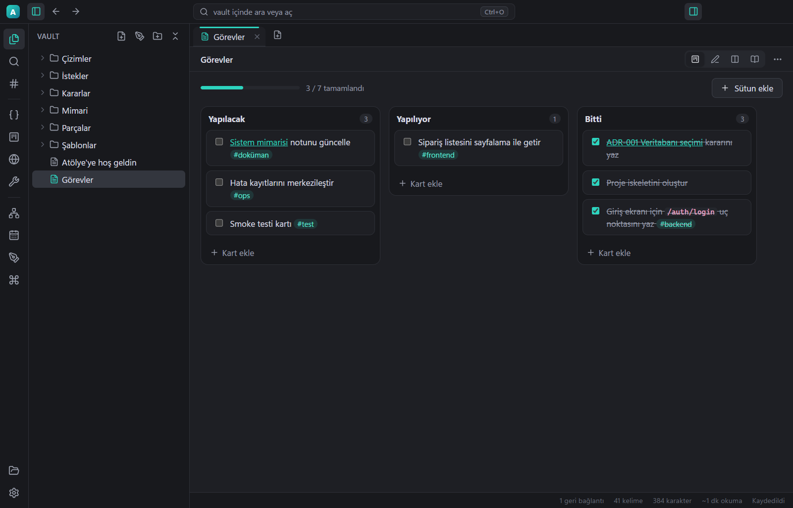

# Atölye

Yazılımcılar için yerel, sade ve hızlı bir çalışma alanı (Windows). Obsidian tarzı notların üstüne geliştiriciye özel beş bölüm ve bir Ajanlar ekranı:

| Bölüm | Ne işe yarar | Kısayol |
|---|---|---|
| 📝 Notlar | Markdown, `[[bağlantılar]]`, geri bağlantılar, grafik, Mermaid şemaları, Excalidraw çizimleri, KaTeX | `Ctrl+N` |
| 🧩 Kod parçaları | Gerçek kaynak dosyaları; ara, dile göre filtrele, etiketle, tek tıkla kopyala | `Ctrl+Alt+S` |
| 📋 Görev panosu | Sürükle-bırak Kanban; sütun ve satır (`### Satır`) eklenebilir, düz Markdown'a kaydedilir (`atolye: board`). Yeni pano: `Ctrl+Alt+N` | `Ctrl+Alt+B` |
| 🌐 HTTP istekleri | REST Client uyumlu `.http` dosyaları, değişkenler, JSON yanıt, cURL'e kopyala | `Ctrl+Alt+H` |
| 🔧 Araçlar | JSON, metin karşılaştırma, Regex, JWT, Base64, URL, zaman damgası, UUID, hash, sayı tabanı, renk, metin dönüştürme | `Ctrl+Alt+A` |

**Yan yana bölmeler (VS Code gibi):** notları, kodları, çizimleri, panoyu ve araçları en fazla 6 bölmede yan yana aç.

| Nasıl | Ne olur |
|---|---|
| Sekme çubuğundaki bölme düğmesi / sekmeye sağ tık → *Sağa böl* | Dosya sağda yeni bölmede de açılır (aynı notun iki kopyası eşzamanlı güncellenir) |
| Sekmeyi başka bölmenin sekme çubuğuna sürükle | Sekme o bölmeye taşınır |
| Sekmeyi ya da kenar çubuğundaki dosyayı bir bölmenin sol/sağ kenarına sürükle | O tarafta yeni bölme açılır |
| Kenar çubuğunda `Alt`+tık · Hızlı açta `Alt+Enter` | Dosyayı yanda açar |
| `Ctrl+1` … `Ctrl+6` | O bölmeye geç (bir sonraki bölme yoksa etkin dosyayı oraya böler) |
| `Ctrl+Alt+←` / `Ctrl+Alt+→` | Etkin sekmeyi soldaki / sağdaki bölmeye taşır |
| Bölmeler arasındaki çizgiyi sürükle · çift tıkla | Genişliği değiştir · eşitle |

Bölmeler ve genişlikleri kapatıp açınca geri gelir. Çizimler tek bölmede açık olabilir (iki kopya birbirinin kaydını ezmesin diye bölme yerine taşınır).

Ayrıca: komut paleti (`Ctrl+P`), hızlı aç (`Ctrl+O`), tam metin arama, şablonlar (ADR, hata raporu, API dokümanı, kod incelemesi…), günlük not, PDF/HTML dışa aktarma, açık/koyu tema.



## Görünüm ve oturum (v1.4)

- **Renk teması:** Ayarlar → *Renk teması*: Kum (varsayılan, sıcak krem), Okyanus, Orman, Lavanta, Klasik; her biri açık ve koyu. *Vurgu rengi* ayrıca seçilebilir.
- **Oturum hatırlanır:** açık sekmeler ve bölmeler, açık klasörler, sol/sağ panelin açık olup olmadığı ve hangi bölümünün seçili olduğu, Ajanlar ekranındaki son sekme.

## Obsidian'dan gelenler (v1.2)

| Özellik | Nasıl |
|---|---|
| Yer imleri | Dosyaya sağ tık → *Yer imlerine ekle* ya da `Ctrl+Alt+M`; dosya ağacının üstünde görünür |
| Bağlantı önizlemesi | Okuma modunda `[[bağlantı]]`ın üstünde bekle: notun başı açılır |
| Bağlantısız anmalar | Sağ panel → Bağlantılar: adı geçen ama bağlantı verilmemiş notlar |
| Özellikler | Sağ panel → Özellikler: notun başındaki `---` bloğu tablo olarak |
| Dosya geçmişi | `Ctrl+Alt+Y` ya da sağ tık → *Dosya geçmişi*: son 30 sürüm (en çok 5 dakikada bir), önizle ve geri yükle |

## 🤖 Ajanlar (`Ctrl+Alt+J`)

Basketball APP ajan sistemini (gizli `soyleremo3/basketball-agents` reposu) tek ekranda gösterir. **3B ofis:** her ekip bir oda, her ajan masasında oturan bir köpek (uyuyor / çalışıyor / bitti / takıldı / hata); köpeğe tıkla → ayrıntı.

| Sekme | Ne yapar |
|---|---|
| Ofis | Her rol bir kart: model, takvim, son iş, sıradaki iş, takıldığı yer; görev tanımı ve defteri tek tıkla |
| Onaylar | Ajanların önemli işler için sorduğu onaylar: **Onayla / Reddet** (+ not); şeritte rozet |
| Pano | İş panosu (bekleyen / yapılıyor / bitti / sonuçlar) ve **yeni görev** ekleme |
| Raporlar | Günlük, haftalık, aylık raporlar |
| Notlar | Ajanlara bilgi ver; hangi rollerin bilmesi gerektiğini seç |
| Çalıştır | Acil işte bir rolü bu PC'de `claude -p` ile **hemen çalıştır** (Claude Pro kotası); aynı anda tek ajan |

Klasörler kendiliğinden bulunur (`Masaüstü/Basketball APP/basketball-agents` ve `version6`); değilse sağ üstteki klasör düğmesinden seçilir. Görünüm açıkken 20 sn'de bir yenilenir, 5 dakikada bir `git pull` yapar; yazılan her karar/görev/not commit edilip gönderilir (internet yoksa sonraki eşitlemede).
Duman testi: `ATOLYE_AGENTS=<geçici ajan reposu> ATOLYE_SMOKE_PHASE=agents`.

## Güvenlik
- Electron güvenlik önerileri: `contextIsolation`, `sandbox`, sıkı CSP, uygulama sadece kendi `atolye://` protokolünden yüklenir.
- Dosya erişimi seçtiğin kasa klasörüyle sınırlı; silinen dosyalar Geri Dönüşüm Kutusu'na gider; kayıtlar atomik.
- İnternete sadece HTTP istemcisinde **sen "Gönder"e bastığında** çıkar (http/https, zaman aşımı, 5 MB yanıt sınırı).

## Geliştirme
```bash
npm install
npm run dev
npm run typecheck
npm run dist     # release/win-unpacked/Atolye.exe
```
Uçtan uca test: `ATOLYE_USER_DATA`, `ATOLYE_VAULT`, `ATOLYE_SMOKE` ortam değişkenleriyle `npx electron .`
