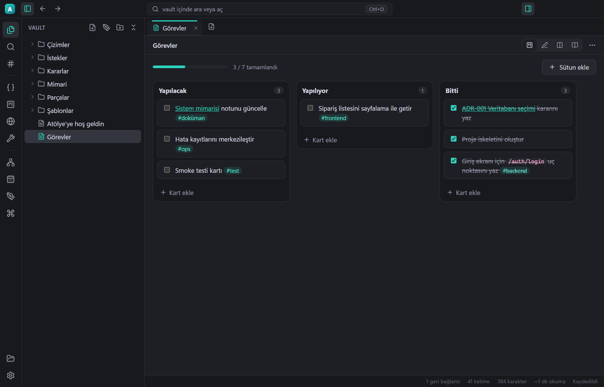

# Atölye

Yazılımcılar için yerel, sade ve hızlı bir çalışma alanı (Windows). Obsidian tarzı notların üstüne geliştiriciye özel beş bölüm:

| Bölüm | Ne işe yarar | Kısayol |
|---|---|---|
| 📝 Notlar | Markdown, `[[bağlantılar]]`, geri bağlantılar, grafik, Mermaid şemaları, Excalidraw çizimleri, KaTeX | `Ctrl+N` |
| 🧩 Kod parçaları | Gerçek kaynak dosyaları; ara, dile göre filtrele, etiketle, tek tıkla kopyala | `Ctrl+Alt+S` |
| 📋 Görev panosu | Sürükle-bırak Kanban; sütun ve satır (`### Satır`) eklenebilir, düz Markdown'a kaydedilir (`atolye: board`). Yeni pano: `Ctrl+Alt+N` | `Ctrl+Alt+B` |
| 🌐 HTTP istekleri | REST Client uyumlu `.http` dosyaları, değişkenler, JSON yanıt, cURL'e kopyala | `Ctrl+Alt+H` |
| 🔧 Araçlar | JSON, metin karşılaştırma, Regex, JWT, Base64, URL, zaman damgası, UUID, hash, sayı tabanı, renk, metin dönüştürme | `Ctrl+Alt+A` |

**Yan yana bölmeler (VS Code gibi):** notları, kodları, çizimleri, panoyu ve araçları en fazla 6 bölmede yan yana aç.

| Nasıl | Ne olur |
|---|---|
| Sekme çubuğundaki bölme düğmesi / sekmeye sağ tık → *Sağa böl* | Dosya sağda yeni bölmede de açılır (aynı notun iki kopyası eşzamanlı güncellenir) |
| Sekmeyi başka bölmenin sekme çubuğuna sürükle | Sekme o bölmeye taşınır |
| Sekmeyi ya da kenar çubuğundaki dosyayı bir bölmenin sol/sağ kenarına sürükle | O tarafta yeni bölme açılır |
| Kenar çubuğunda `Alt`+tık · Hızlı açta `Alt+Enter` | Dosyayı yanda açar |
| `Ctrl+1` … `Ctrl+6` | O bölmeye geç (bir sonraki bölme yoksa etkin dosyayı oraya böler) |
| `Ctrl+Alt+←` / `Ctrl+Alt+→` | Etkin sekmeyi soldaki / sağdaki bölmeye taşır |
| Bölmeler arasındaki çizgiyi sürükle · çift tıkla | Genişliği değiştir · eşitle |

Bölmeler ve genişlikleri kapatıp açınca geri gelir. Çizimler tek bölmede açık olabilir (iki kopya birbirinin kaydını ezmesin diye bölme yerine taşınır).

Ayrıca: komut paleti (`Ctrl+P`), hızlı aç (`Ctrl+O`), tam metin arama, şablonlar (ADR, hata raporu, API dokümanı, kod incelemesi…), günlük not, PDF/HTML dışa aktarma, açık/koyu tema.



## Güvenlik
- Electron güvenlik önerileri: `contextIsolation`, `sandbox`, sıkı CSP, uygulama sadece kendi `atolye://` protokolünden yüklenir.
- Dosya erişimi seçtiğin kasa klasörüyle sınırlı; silinen dosyalar Geri Dönüşüm Kutusu'na gider; kayıtlar atomik.
- İnternete sadece HTTP istemcisinde **sen "Gönder"e bastığında** çıkar (http/https, zaman aşımı, 5 MB yanıt sınırı).

## Geliştirme
```bash
npm install
npm run dev
npm run typecheck
npm run dist     # release/win-unpacked/Atolye.exe
```
Uçtan uca test: `ATOLYE_USER_DATA`, `ATOLYE_VAULT`, `ATOLYE_SMOKE` ortam değişkenleriyle `npx electron .`
